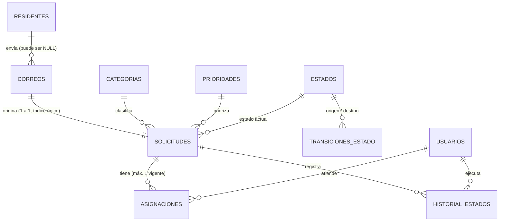

# SOC-CRM — Guía de estudio: qué hace el sistema y qué hace especial a su base de datos transaccional

Documento para **entender y poder defender** el MVP. Todo lo que aquí se afirma está implementado y probado en el repositorio (180 pruebas contra SQL Server real, más pruebas de mutación). Donde algo **no** está hecho, se dice explícitamente (§9). Versión revisada tras una auditoría con agentes especializados (§12).

Contenido

1. [Qué problema resuelve y qué hace el sistema](#1-qué-problema-resuelve-y-qué-hace-el-sistema)
2. [Mapa del sistema y del código](#2-mapa-del-sistema-y-del-código)
3. [El modelo de datos](#3-el-modelo-de-datos)
4. [Qué significa «transaccional» y por qué importa aquí](#4-qué-significa-transaccional-y-por-qué-importa-aquí)
5. [Las garantías de la base de datos (el corazón del proyecto)](#5-las-garantías-de-la-base-de-datos)
6. [Las transacciones del negocio, paso a paso](#6-las-transacciones-del-negocio-paso-a-paso)
7. [Cómo se demuestra que funciona (pruebas)](#7-cómo-se-demuestra-que-funciona)
8. [Experimentos para hacer usted mismo](#8-experimentos-para-hacer-usted-mismo)
9. [Qué falta y limitaciones honestas](#9-qué-falta-y-limitaciones-honestas)
10. [Preguntas de estudio con respuesta](#10-preguntas-de-estudio-con-respuesta)
11. [Glosario](#11-glosario)
12. [Qué cambió con la auditoría](#12-qué-cambió-con-la-auditoría)

---

## 1. Qué problema resuelve y qué hace el sistema

**Problema (del informe):** un conjunto residencial recibe por correo mantenimiento, quejas, cobros, incidentes de seguridad… Se leen a mano, sin clasificar, sin prioridad, sin saber quién lo atiende ni en qué estado está.

**Qué hace el sistema:** convierte **cada correo en una solicitud** con categoría, prioridad, estado, responsable e historial completo, de forma que nada se pierda, nada se duplique y todo cambio quede registrado.

### Flujo de vida de una solicitud

```
 Correo llega
     │  (T1) se guarda UNA sola vez, se clasifica y se prioriza
     ▼
  ┌───────┐ asignar (T2) ┌──────────┐  iniciar  ┌────────────┐ resolver ┌──────────┐ cerrar ┌─────────┐
  │ NUEVA │─────────────►│ ASIGNADA │──────────►│ EN_PROCESO │─────────►│ RESUELTA │───────►│ CERRADA │
  └───────┘              └────┬─────┘  (T3)     └─────▲──────┘   (T3)   └────┬─────┘  (T3)  └─────────┘
      ▲   desasignar (T3)     │                       └──── reabrir (T3) ────┘     (final: libera al
      └───────────────────────┘                                                     responsable y ya
   En cualquier momento (menos CERRADA): reclasificar categoría/prioridad (T4)       no se modifica)
```

### Funcionalidades implementadas

| # | Funcionalidad | Qué hace en concreto | Código |
|---|---|---|---|
| 1 | **Ingesta de correos** (T1) | Guarda el correo (con emojis y cualquier alfabeto), lo vincula al residente si lo conoce, crea la solicitud y su primer registro de historial. Reprocesar el mismo correo no hace nada. Nunca descarta un correo: lo que no cabe se recorta y un remitente inválido se guarda como `desconocido@invalid`. | `modules/ingesta.ts` |
| 2 | **Clasificación** | Una de 4 categorías por palabras clave; el asunto pesa el doble. Si **ninguna** regla coincide queda `SIN_CLASIFICAR` para que lo revise una persona (una sola coincidencia débil ya decide: es un clasificador simple). | `domain/clasificador.ts` |
| 3 | **Priorización** | Base por categoría (SEGURIDAD=ALTA, MANTENIMIENTO=MEDIA, FACTURACION/ADMINISTRATIVO=BAJA) y sube a ALTA con señales de urgencia («incendio», «persona atrapada», «fuga de gas»…). | `domain/priorizador.ts` |
| 4 | **Asignar / reasignar** (T2) | Vincula la solicitud a un usuario; reasignar libera al anterior y queda en el historial. | `modules/asignaciones.ts` |
| 5 | **Cambiar estado** (T3) | Solo transiciones válidas; registra quién, cuándo y por qué; marca primera respuesta y cierre; al cerrar libera al responsable. | `modules/solicitudes.ts` |
| 6 | **Reclasificar** (T4) | Una persona corrige al clasificador; queda escrito qué cambió. Si no cambia nada, no toca la BD. | `modules/solicitudes.ts` |
| 7 | **Checkpoint IMAP** (T6) | Recuerda hasta qué correo del buzón se procesó, en la misma transacción; se reinicia si Gmail cambia el `UIDVALIDITY`. | `modules/ingesta.ts` |
| 8 | **Consultas** | Bandeja con filtros y paginación, detalle e indicadores (carga, tiempo de respuesta, % dentro del SLA) en lectura consistente. | `modules/consultas.ts` |
| 9 | **Visor de demostración** | Pantalla local para ver todo lo anterior funcionando. Provisional. | `demo/` |

### Reglas de negocio que el sistema hace cumplir (y quién las hace cumplir)

| Regla | Código | BD |
|---|---|---|
| Un correo produce exactamente una solicitud | ✔ | ✔ índice único |
| Un correo no se procesa dos veces | ✔ | ✔ índice único (sensible a mayúsculas) |
| Solo transiciones de estado permitidas; CERRADA es final e inmodificable | ✔ | ✔ trigger |
| Una solicitud ASIGNADA siempre tiene responsable | ✔ | ✔ trigger |
| Como máximo un responsable vigente | ✔ | ✔ índice único filtrado |
| `fechaCierre` existe si y solo si la solicitud está cerrada | ✔ | ✔ trigger |
| Cambiar una solicitud exige haber visto su versión actual (si no, 409) | ✔ | — |
| Todo cambio de estado deja historial | ✔ | — |
| El historial no se puede editar ni borrar | — | ✔ trigger + permisos |
| La aplicación no puede borrar filas ni alterar el esquema | — | ✔ rol `crm_app` |

---

## 2. Mapa del sistema y del código

Arquitectura en capas del informe (presentación / lógica de negocio / datos), más el Email Gateway. La lógica de negocio sigue el patrón **Transaction Script**: cada caso de uso es una función que abre una transacción, valida, escribe y deja historial. La **capa de datos** no es solo tablas: incluye restricciones, triggers y permisos.

```
┌───────────────────┐  REST  ┌────────────────────────────────────┐        ┌──────────────────────┐
│ Panel (S5 · falta)│◄──────►│ LÓGICA DE NEGOCIO                  │        │ DATOS                │
│ hoy: visor demo   │        │  domain/  reglas puras (sin BD)    │ withTx │  db/ (withTx, pool)  │
└───────────────────┘        │  modules/ transacciones T1..T4     │───────►│  SQL Server:         │
┌───────────────────┐        │           consultas (lectura)      │ login  │  tablas, FK/CHECK,   │
│ Email Gateway (S3)│───────►│                                    │ crm_app│  índices, triggers,  │
└───────────────────┘   T1   └────────────────────────────────────┘        │  rol crm_app         │
                                                                            └──────────────────────┘
```

```
CRM-Residencial/
├─ ScriptBaseDatosCRM.sql        # línea base (la hizo el equipo; no se edita)
├─ db/migrations/
│   ├─ 0002_integridad.sql       # vuelve transaccional la línea base
│   ├─ 0003_fechas_datetime2.sql # corrige un bug de redondeo de fechas
│   ├─ 0004_invariantes_y_texto.sql  # reglas de estado en la BD, Unicode, catálogos canónicos
│   └─ 0005_rol_aplicacion.sql   # rol de mínimo privilegio para la aplicación
├─ apps/api/src/
│   ├─ domain/      clasificador, priorizador, estados  ← lógica PURA
│   ├─ modules/     ingesta (T1), asignaciones (T2), solicitudes (T3, T4), consultas
│   ├─ db/          withTx, pool, migrate, usuarioApp
│   ├─ errors.ts    ConflictError, TransicionInvalida, NotFound, ValidationError
│   └─ demo/        visor provisional
└─ apps/api/test/   helpers y datos de prueba (fuera del código de producción)
```

**Idea clave — defensa en profundidad:** el código valida primero (para dar mensajes claros: 409, 422) y la base de datos repite las reglas críticas (para que nadie pueda saltárselas con SQL directo o con un bug). Lo que todavía solo garantiza el código está marcado en la tabla de §1.

---

## 3. El modelo de datos

### Tablas y para qué sirve cada una

| Tabla | Propósito | ¿La usa el código hoy? |
|---|---|---|
| `RESIDENTES` | Quién envía correos (nombre, unidad, correo único). | Sí (vincula remitente) |
| `USUARIOS` | Personal: rol `ADMIN`/`SOPORTE`, activo, hash de contraseña. | Sí |
| `CATEGORIAS` | `MANTENIMIENTO`, `ADMINISTRATIVO`, `FACTURACION`, `SEGURIDAD`, `SIN_CLASIFICAR`. | Sí |
| `ESTADOS` | `NUEVA`, `ASIGNADA`, `EN_PROCESO`, `RESUELTA`, `CERRADA` (`esFinal`). | Sí |
| `PRIORIDADES` | `ALTA`/`MEDIA`/`BAJA` con su peso y **SLA en horas** (4/24/72). | Sí |
| `TRANSICIONES_ESTADO` | **La máquina de estados como datos**. | Sí (código y trigger) |
| `CORREOS` | Cada correo recibido; `messageId` **único y sensible a mayúsculas**; texto en NVARCHAR. | Sí |
| `SOLICITUDES` | Tabla central: una por correo; categoría, prioridad, estado, `version`, primera respuesta y cierre. | Sí |
| `ASIGNACIONES` | Quién atiende; `liberadaEn` NULL = vigente; `asignadaPor`. | Sí |
| `HISTORIAL_ESTADOS` | Bitácora **inmutable** de cada cambio. | Sí |
| `GATEWAY_CHECKPOINT` | Hasta qué UID del buzón IMAP se procesó. | Sí (T6) |
| `NOTIFICACIONES`, `REPORTES` | Vienen de la línea base. | **No** todavía |
| `__MIGRACIONES` | Qué migraciones se aplicaron (con checksum). | Sí (solo el migrador) |

Los nombres de catálogo y los roles se guardan en **MAYÚSCULAS exactas** (lo exige un `CHECK` binario) y son los que se usan en el código y en las consultas.

### Relaciones principales



### Qué se agregó a la línea base y por qué

| Problema de la línea base | Solución | Migración |
|---|---|---|
| El mismo correo podía insertarse dos veces | `CORREOS.messageId` + índice único (después, sensible a mayúsculas) | 0002, 0004 |
| Un correo podía originar varias solicitudes | Índice único `UX_Solicitudes_idCorreo` | 0004 |
| Un remitente desconocido rompía la inserción | `CORREOS.idResidente` admite NULL | 0002 |
| Cualquier estado podía saltar a cualquier otro | Tabla `TRANSICIONES_ESTADO` + trigger que la hace cumplir | 0002, 0004 |
| Prioridad como texto libre (`'alta'`, `'urgente!!'`) | Tabla `PRIORIDADES` + FK | 0002 |
| Nadie detectaba ediciones simultáneas | `SOLICITUDES.version` | 0002 |
| Varias asignaciones activas a la vez | Índice único **filtrado** | 0002 |
| Sin trazabilidad de estados | `HISTORIAL_ESTADOS` + trigger de inmutabilidad | 0002 |
| Fechas `DATETIME` con redondeo de 3,33 ms | `DATETIME2` | 0003 |
| Emojis y alfabetos no latinos se guardaban como `?` | Texto del correo y nombres en `NVARCHAR` | 0004 |
| `'asignada'` y `'ASIGNADA'` eran iguales para la BD | Catálogos y roles en mayúsculas exactas (CHECK binario) | 0004 |
| La aplicación se conectaba como administrador | Rol `crm_app` de mínimo privilegio | 0005 |

---

## 4. Qué significa «transaccional» y por qué importa aquí

Una **transacción** es un grupo de operaciones que se trata como una sola unidad: o se aplican **todas** o **ninguna**. Se resume en ACID:

| Propiedad | Idea | Ejemplo en este proyecto |
|---|---|---|
| **A**tomicidad | Todo o nada | Si falla al guardar el historial, tampoco queda la solicitud ni el correo. |
| **C**onsistencia | Los datos siempre cumplen las reglas | Imposible tener dos responsables vigentes, una solicitud ASIGNADA sin responsable o un estado inválido. |
| **A**islamiento | Operaciones simultáneas no se estorban | Dos administradores cambiando la misma solicitud no se pisan. |
| **D**urabilidad | Lo confirmado no se pierde | Tras `COMMIT`, queda en el registro de transacciones de SQL Server. |

**Por qué un CRM de correos lo necesita:** hay concurrencia real (varias personas y el gateway a la vez), reintentos (el gateway puede caerse y releer correos) y valor de auditoría (¿quién cambió qué y cuándo?).

---

## 5. Las garantías de la base de datos

Cada una indica **qué previene**, **cómo**, **dónde** y **cómo se prueba**.

### G1 · Idempotencia: un correo se procesa una sola vez
- **Previene:** duplicados si el gateway reinicia, reintenta o hay dos procesos.
- **Cómo:** índice único sobre `messageId` con collation **binaria** (`Latin1_General_100_BIN2`): `<Ab@x>` y `<ab@x>` son correos distintos, como dice el estándar de correo. Un Message-ID más largo que la columna se guarda como hash estable.
- **Prueba:** 50 ingestas simultáneas del mismo correo → 1 correo, 1 solicitud, 1 historial.

### G2 · Un correo, exactamente una solicitud
- **Cómo:** índice único `UX_Solicitudes_idCorreo`. Antes solo lo garantizaba que T1 fuera el único camino de entrada.
- **Prueba:** un segundo `INSERT` directo con el mismo correo es rechazado.

### G3 · Una sola asignación vigente (índice único *filtrado*)
```sql
CREATE UNIQUE INDEX UX_Asignaciones_vigente
    ON dbo.ASIGNACIONES (idSolicitud) WHERE liberadaEn IS NULL;
```
- La unicidad solo se exige entre las vigentes; las liberadas se conservan como historia.
- **Prueba:** 20 asignaciones simultáneas → siempre exactamente 1 vigente.

### G4 · Reglas del ciclo de vida en la BD (trigger `TR_Solicitudes_integridad`)
Un trigger `AFTER INSERT, UPDATE` sobre `SOLICITUDES` rechaza (con `THROW`):
- crear una solicitud en un estado distinto de NUEVA;
- un cambio de estado que no esté en `TRANSICIONES_ESTADO` (p. ej. `NUEVA → CERRADA`);
- dejar una solicitud ASIGNADA sin responsable vigente;
- `fechaCierre` en un estado no final, o un estado final sin `fechaCierre`;
- cualquier modificación de una solicitud que ya está en un estado final.

Otro trigger impide declarar transiciones que salgan de un estado final.
- **Prueba:** `constraints.test.ts` intenta cada violación con SQL directo y verifica el rechazo; también recorre el ciclo válido completo por SQL.

### G5 · Concurrencia optimista con `version`
- **Previene:** la «actualización perdida»: A y B leen la v3; A guarda y B sobrescribe sin saberlo.
- **Cómo:** **todas** las escrituras sobre una solicitud (T2, T3, T4) exigen la versión que vio el cliente y la incrementan (`... WHERE version = @v`). Si cambió → `ConflictError` (HTTP 409).
- **Prueba:** 10 cambios de estado simultáneos y 20 asignaciones simultáneas con la misma versión → exactamente 1 gana, el resto recibe 409.

### G6 · Bloqueo pesimista de fila: `UPDLOCK`
- `SELECT ... WITH (UPDLOCK, ROWLOCK)` serializa a quienes modifican la misma solicitud; el segundo espera y luego ve los datos actualizados.
- **G5 y G6 se complementan:** el bloqueo dura milisegundos (dentro del servidor); la versión protege la vista que el usuario tiene abierta durante minutos.

### G7 · Aislamiento: RCSI + SNAPSHOT
- `READ_COMMITTED_SNAPSHOT`: los lectores ven la última versión confirmada sin bloquear a escritores.
- `SNAPSHOT`: las consultas de `consultas.ts` (bandeja, detalle, indicadores) leen **una foto consistente**: la versión, el historial y las asignaciones de un detalle son del mismo instante.

### G8 · Reintento automático ante deadlock
- Deadlock: A bloquea la fila 1 y pide la 2; B bloquea la 2 y pide la 1. SQL Server aborta a una (error 1205). `withTx` repite la transacción completa (hasta 3 intentos); los demás errores no se reintentan.
- **Prueba:** se provoca un deadlock real; la víctima reintenta y ambas terminan con valores correctos.

### G9 · Atomicidad comprobada con fallos inyectados
- Cada transacción acepta un parámetro `hooks` que en las pruebas lanza un error **después de cada paso**; se compara una foto de 5 tablas antes y después: **idénticas**. Probado en T1, T2, T3 (incluido el cierre, que libera la asignación) y T4.

### G10 · Historial inmutable
```sql
CREATE OR ALTER TRIGGER dbo.TR_Historial_inmutable ON dbo.HISTORIAL_ESTADOS
INSTEAD OF UPDATE, DELETE AS
BEGIN
    SET NOCOUNT ON;
    THROW 50001, 'HISTORIAL_ESTADOS es de solo inserción: no se permite UPDATE ni DELETE.', 1;
END;
```
- Y además el rol `crm_app` tiene `DENY UPDATE, DELETE` sobre esa tabla (ver G12).

### G11 · Integridad referencial, de dominio y de texto
- **FK** en todas las relaciones, sin cascada: no se borra nada que esté en uso.
- **CHECK:** `version >= 1`, `slaHoras > 0`, fechas coherentes, rol válido, nombres de catálogo en mayúsculas exactas, checkpoint con valores positivos, transición a sí mismo prohibida.
- **Únicos:** correo de residente y de usuario, nombres de categoría/estado/prioridad.
- **Unicode:** asunto, cuerpo, remitente y nombres en `NVARCHAR`: «Fuga 🚰 en 公寓» se guarda tal cual.

### G12 · Mínimo privilegio: la aplicación no es administradora
- Hay **dos identidades**: el **migrador** (crea la BD y aplica DDL) y la **aplicación** (`soc_app`, miembro del rol `crm_app`).
- `crm_app` puede leer, insertar y actualizar las tablas operativas e insertar historial. **No puede** borrar filas, modificar o borrar historial, ni alterar el esquema; `DENY ALTER` también impide `TRUNCATE TABLE` y `DISABLE TRIGGER`.
- Sin esto, las garantías G3, G4 y G10 serían solo «buenas intenciones»: con `sa` cualquiera puede desactivar un trigger.
- **Prueba:** `roles.test.ts` se conecta como la aplicación e intenta `UPDATE`/`DELETE`/`TRUNCATE` del historial, `DISABLE TRIGGER`, `ALTER TABLE`, `DROP TABLE` y leer las migraciones: todo rechazado y sin efecto.

> **Caso de estudio 1 — el bug de las fechas (0003).** Una prueba fallaba a veces: `fechaAsignacion` era `DATETIME` (redondea a ~3,33 ms) y `liberadaEn` era `DATETIME2`. Al liberar una asignación recién creada, el redondeo podía dejar la liberación *antes* de la asignación y el `CHECK` rechazaba una operación válida. Se corrigió con una migración nueva, sin editar la anterior.
>
> **Caso de estudio 2 — la collation (0004).** La auditoría encontró que enviar el estado `'asignada'` (en minúsculas) permitía dejar una solicitud ASIGNADA **sin responsable**: la BD encontraba el estado porque su collation no distingue mayúsculas, pero el código comparaba `'asignada' === 'ASIGNADA'` → falso y se saltaba la regla. Lección: comparar siempre con el valor canónico de la BD, validar la entrada contra una lista cerrada y, como última defensa, poner la regla en la BD.

---

## 6. Las transacciones del negocio, paso a paso

Todas se ejecutan dentro de `withTx()`: `BEGIN` → lógica → `COMMIT`; si algo lanza → `ROLLBACK`. Toda entrada se valida antes con un esquema `zod` (error 422 si no es válida).

### T1 · Ingesta de un correo (`ingestarCorreo`)
```
(antes de la transacción) normaliza la entrada y clasifica/prioriza
BEGIN
  1. INSERT correo ──(¿messageId repetido? → NO-OP, solo se avanza el checkpoint)
  2.   · vincula residente por remitente (o NULL si es desconocido)
  3. INSERT solicitud (estado NUEVA; si el catálogo no tuviera la categoría → SIN_CLASIFICAR)
  4. INSERT historial (NULL → NUEVA, «Creada automáticamente desde correo»)
  5. UPSERT checkpoint IMAP con UPDLOCK+HOLDLOCK (sin carrera al crearlo; se reinicia si cambia UIDVALIDITY)
COMMIT
```
Lectura *al menos una vez* + escritura idempotente = **efectivamente una sola vez**.

### T2 · Asignar / reasignar (`asignar`)
```
BEGIN
  1. Bloquea la solicitud (UPDLOCK) y exige la versión esperada         → 409
  2. Estado asignable (NUEVA/ASIGNADA/EN_PROCESO); responsable y asignador activos → 422
  3. ¿Ya es el responsable vigente? → sin cambios
  4. Libera la asignación vigente
  5. Inserta la nueva                                                   ← índice filtrado: única vigente
  6. Historial: «Asignada a …» (NUEVA → ASIGNADA) o «Reasignada a …»
  7. UPDATE estado/version ... WHERE version = @v                        ← trigger: ASIGNADA con responsable
COMMIT
```

### T3 · Cambiar estado (`cambiarEstado`)
```
BEGIN
  1. Bloquea la solicitud y compara la versión                          → 409
  2. Usuario existe y está activo                                        → 422
  3. Busca el estado destino y usa su nombre CANÓNICO de la BD
  4. Consulta TRANSICIONES_ESTADO                                        → 422 TransicionInvalida
  5. Destino ASIGNADA → rechazado (solo se llega asignando)
  6. Destino NUEVA (desasignar) o final (cerrar) → libera la asignación vigente
  7. UPDATE estado, version+1, primeraRespuesta, fechaCierre             ← el trigger repite las reglas
  8. INSERT historial
COMMIT
```

### T4 · Reclasificar (`reclasificar`)
Bloquea, valida versión y que no esté CERRADA; si la categoría y la prioridad no cambian, **no escribe nada** (no sube la versión, evitando conflictos inútiles a otros usuarios); si cambian, actualiza, sube la versión y deja en el historial exactamente qué cambió.

### `withTx` — el envoltorio de todas
```ts
for (intento = 1; ; intento++) {
  await transaction.begin(nivelDeAislamiento);
  try {
    const resultado = await fn(tx);
    await transaction.commit();
    return resultado;
  } catch (err) {
    await transaction.rollback();   // si ya la abortó el servidor (deadlock, trigger), se ignora;
                                    // cualquier otro fallo del rollback se registra
    if (esTransitorio(err) && intento < maxIntentos) continue;   // 1205 / 3960
    throw err;
  }
}
```

### Las migraciones también son transaccionales
Cada migración va en su propia transacción con `XACT_ABORT ON` (cualquier error aborta todo), se registra con un **checksum** (editarla después se rechaza; el checksum ignora fines de línea y BOM), y un bloqueo (`sp_getapplock`) impide que dos procesos migren o creen la BD a la vez. Al terminar, el runner crea o actualiza el login de la aplicación y lo agrega al rol `crm_app`.

---

## 7. Cómo se demuestra que funciona

`npm run gate` ejecuta: migraciones → lint (incluye reglas que prohíben SQL interpolado e imports de BD en el dominio) → tipos → **180 pruebas** contra SQL Server real.

| Archivo de pruebas | Pruebas | Qué demuestra |
|---|---|---|
| `db/splitBatches.test.ts` | 10 | Separador `GO`: comentarios de bloque, cadenas, CRLF y todos los scripts reales. |
| `db/migrate.test.ts` | 7 | Migraciones idempotentes y atómicas; detección de ediciones; checksum estable con BOM/CRLF. |
| `db/migration0002.test.ts` | 13 | La migración conserva datos antiguos (messageId sintético, prioridad texto→FK, una vigente). |
| `db/constraints.test.ts` | 65 | Cada FK, CHECK, UNIQUE y NOT NULL; reglas del trigger por SQL directo; catálogos canónicos; Unicode; 500 crear/liberar. |
| `db/withTx.test.ts` | 9 | Commit, rollback, reintentos, niveles de aislamiento, **deadlock real**, 20 escritores sin pérdida. |
| `db/roles.test.ts` | 7 | La aplicación (rol `crm_app`) opera, pero no puede alterar historial, borrar, truncar ni desactivar triggers, ni siquiera si alguien le da roles amplios. |
| `domain/domain.test.ts` | 14 | Clasificador, priorizador y máquina de estados (sin BD). |
| `modules/ingesta.test.ts` | 14 | Idempotencia, 50 en paralelo, Unicode, recortes, remitentes inválidos, UIDVALIDITY, carrera del checkpoint. |
| `modules/transacciones.test.ts` | 41 | T2/T3/T4, estados no canónicos, cierre, validaciones, concurrencia y **atomicidad con fallos inyectados**. |

**Pruebas de mutación:** además, se rompió a propósito cada garantía en una copia del código (quitar `UPDLOCK`, el índice único, el trigger, los `DENY`, la collation binaria…) y se verificó que alguna prueba falla. Resultados en §12.

---

## 8. Experimentos para hacer usted mismo

Conéctese a la BD de demostración (Azure Data Studio, SSMS o `sqlcmd`): servidor `localhost,1433`, base `CorreosCRM_demo`, usuario `sa` y la contraseña `DB_MIGRATOR_PASSWORD` de **su** archivo `.env` (no está en el repositorio). Con el visor corriendo (`npm run demo`) la BD ya tiene datos.

```bash
# Git Bash: lee la contraseña de su .env sin mostrarla
PW=$(grep ^DB_MIGRATOR_PASSWORD= .env | cut -d= -f2-)
MSYS_NO_PATHCONV=1 docker exec -it crm-residencial-db-1 /opt/mssql-tools18/bin/sqlcmd -C -I -S localhost -U sa -P "$PW" -d CorreosCRM_demo
```
> **El `-I` es necesario.** `sqlcmd` arranca con `QUOTED_IDENTIFIER OFF` y SQL Server prohíbe escribir en tablas con índices filtrados (`ASIGNACIONES`, `RESIDENTES`) en ese modo (error 1934). Las demás herramientas y el driver de la aplicación ya lo traen activo.

**1 — El historial no se puede alterar (G10)**
```sql
UPDATE HISTORIAL_ESTADOS SET comentario = 'manipulado';   -- falla: "solo inserción"
DELETE FROM HISTORIAL_ESTADOS;                            -- falla
```

**2 — Un correo no entra dos veces, pero las mayúsculas cuentan (G1)**
```sql
INSERT INTO CORREOS (remitente, messageId) VALUES ('x@y.com', '<demo-0@conjunto>');  -- falla: UX_Correos_messageId
INSERT INTO CORREOS (remitente, messageId) VALUES ('x@y.com', '<DEMO-0@conjunto>');  -- funciona: es otro Message-ID
```

**3 — Un correo, una solicitud (G2)**
```sql
INSERT INTO SOLICITUDES (idCorreo, idCategoria, idEstado, idPrioridad) VALUES (1, 1, 1, 1);  -- falla: UX_Solicitudes_idCorreo
```

**4 — La BD rechaza saltos de estado aunque se escriba SQL directo (G4)**
```sql
SELECT TOP 1 s.idSolicitud FROM SOLICITUDES s JOIN ESTADOS e ON e.idEstado = s.idEstado WHERE e.nombre = 'NUEVA';
-- con ese id (ej. 30):
UPDATE SOLICITUDES SET idEstado = (SELECT idEstado FROM ESTADOS WHERE nombre = 'CERRADA'),
                       fechaCierre = SYSUTCDATETIME() WHERE idSolicitud = 30;    -- falla: transición no permitida
UPDATE SOLICITUDES SET idEstado = (SELECT idEstado FROM ESTADOS WHERE nombre = 'ASIGNADA')
 WHERE idSolicitud = 30;                                                         -- falla: ASIGNADA sin responsable
```

**5 — Dos responsables vigentes son imposibles (G3)**
```sql
INSERT INTO ASIGNACIONES (idSolicitud, idUsuario, asignadaPor) VALUES (1, 2, 1);  -- falla si la 1 ya tiene vigente
```

**6 — Bloqueo de fila entre dos sesiones (G6)** — dos ventanas de consulta:
```sql
-- Ventana A
BEGIN TRAN; SELECT * FROM SOLICITUDES WITH (UPDLOCK, ROWLOCK) WHERE idSolicitud = 10;
-- Ventana B: esta se QUEDA ESPERANDO…
BEGIN TRAN; SELECT * FROM SOLICITUDES WITH (UPDLOCK, ROWLOCK) WHERE idSolicitud = 10;
-- …pero una lectura normal responde al instante (RCSI):
SELECT * FROM SOLICITUDES WHERE idSolicitud = 10;
-- Ventana A: COMMIT;  → B se desbloquea. En B: ROLLBACK;
```

**7 — Conflicto de versión (G5)** — en el visor, abra la misma solicitud en dos pestañas, cambie el estado en una y luego intente en la otra → aviso de conflicto (409).

**8 — Mínimo privilegio (G12)** — conéctese como la aplicación (`-U soc_app -P "$(grep ^DB_PASSWORD= .env | cut -d= -f2-)"`) y pruebe:
```sql
TRUNCATE TABLE HISTORIAL_ESTADOS;                                   -- falla: sin permiso
DISABLE TRIGGER TR_Historial_inmutable ON HISTORIAL_ESTADOS;        -- falla
DELETE FROM CORREOS WHERE idCorreo = 1;                             -- falla: DELETE denegado
SELECT TOP 3 codigo = idSolicitud, version FROM SOLICITUDES;         -- funciona: puede leer
```

**9 — Trazabilidad completa de una solicitud**
```sql
SELECT h.idHistorial, ea.nombre AS desde, en.nombre AS hasta, u.nombre AS quien, h.comentario, h.fecha
FROM HISTORIAL_ESTADOS h
LEFT JOIN ESTADOS ea ON ea.idEstado = h.idEstadoAnterior
JOIN ESTADOS en ON en.idEstado = h.idEstadoNuevo
LEFT JOIN USUARIOS u ON u.idUsuario = h.idUsuario
WHERE h.idSolicitud = 1 ORDER BY h.idHistorial;
```

**10 — Aislamiento activado (G7)**
```sql
SELECT name, is_read_committed_snapshot_on, snapshot_isolation_state_desc FROM sys.databases WHERE name = 'CorreosCRM_demo';
```

---

## 9. Qué falta y limitaciones honestas

### Funcionalidad pendiente (según el plan)
- **Email Gateway real** (S3): hoy los correos entran por el visor o con datos de ejemplo.
- **API REST con login y permisos por rol** (S4): el visor actúa siempre como administrador; la regla «soporte solo cambia sus solicitudes» no existe todavía. Los módulos aún reciben `idUsuario` suelto; en S4 recibirán el usuario con su rol.
- **Panel real** (S5): el visor es provisional y el `index.html` original es una maqueta con datos falsos.
- **Reportes formales** (T5: periodo, exportar CSV): hoy hay indicadores básicos. `REPORTES` y `NOTIFICACIONES` no se usan.
- **Endurecimiento** (S6): pruebas con correos reales y de carga, backup y restauración probados, CI.

### Limitaciones técnicas conocidas
1. **Clasificador por palabras clave.** Acierta 34/34 en un conjunto escrito por el mismo equipo que las reglas (optimista). Una sola coincidencia débil decide la categoría; no entiende negaciones («esto **no** es urgente» sube a ALTA).
2. **Lo que la BD todavía no garantiza:** que cada cambio de estado deje historial y que cada escritura suba `version` (lo hace el código). Y el trigger de `SOLICITUDES` no vigila `ASIGNACIONES`: un `UPDATE` directo que libere la asignación de una solicitud ASIGNADA la dejaría sin responsable (con el rol `crm_app` es posible; el código nunca lo hace). Un administrador de la BD (`sa`) siempre puede desactivar triggers: la defensa contra eso es no usar `sa` en la aplicación y tener backups.
3. **Una sola base de datos, sin réplica ni backups probados** (S6).
4. **Contraseñas de usuarios del sistema:** la columna `passwordHash` existe pero aún no hay login (S4).
5. **Datos personales:** falta definir retención y minimización (S4/S6). Los errores ya no se registran con su contenido.
6. **Los módulos exponen un parámetro `hooks`** que solo existe para las pruebas de fallo.
7. **Identidades no consecutivas:** tras reiniciar SQL Server, los `id` pueden saltar (p. ej. de 36 a 1002). Es normal en SQL Server (caché de identidad) y no afecta la integridad.
8. **Datos legados:** si una BD antigua tuviera roles o estados que no existen en el modelo, la migración 0002 falla de forma segura (no aplica nada) y hay que normalizarlos a mano antes.

---

## 10. Preguntas de estudio con respuesta

1. **¿Qué diferencia hay entre una regla en el código y una en la base de datos?**
   La del código solo protege si todo pasa por ese código; la de la BD protege siempre, incluso ante un bug o un script manual. Aquí se usan **las dos**: el código para dar mensajes claros (409/422) y la BD como última defensa (índices únicos, trigger del ciclo de vida, inmutabilidad, permisos).

2. **¿Cómo se garantiza que un correo no se procese dos veces si el gateway se cae justo después de guardarlo?**
   Se relee, pero el índice único sobre `messageId` rechaza el segundo insert y el código lo interpreta como «ya procesado». Al menos una vez + idempotencia = efectivamente una vez.

3. **¿Por qué `UPDLOCK` y `version` a la vez?**
   `UPDLOCK` serializa a quienes modifican dentro del servidor (milisegundos). `version` detecta que la vista que el usuario tenía abierta (minutos) quedó desactualizada.

4. **¿Qué es un índice único filtrado y por qué resuelve «un responsable vigente»?**
   Un índice que solo cubre las filas que cumplen un predicado (`liberadaEn IS NULL`): exige unicidad solo entre las vigentes y deja acumular las liberadas como historia.

5. **¿Qué ocurre si dos transacciones se bloquean mutuamente?**
   SQL Server detecta el deadlock y aborta una (1205); `withTx` revierte y repite la transacción completa.

6. **¿Por qué las transiciones de estado están en una tabla y además en un trigger?**
   La tabla permite auditar y cambiar el flujo como datos; el trigger hace que la BD rechace cualquier `UPDATE` que no respete esa tabla, aunque venga de fuera de la aplicación.

7. **¿Cómo un simple `'asignada'` en minúsculas rompía una regla y cómo se corrigió?**
   La collation de la BD no distingue mayúsculas (encontraba el estado) pero el código comparaba en binario (no reconocía `ASIGNADA` y no aplicaba la regla). Se corrigió en tres capas: el esquema `zod` solo acepta los nombres exactos, el código compara con el nombre canónico leído de la BD, y un `CHECK` binario obliga a guardar los catálogos en mayúsculas, mientras el trigger repite la regla.

8. **¿Por qué la aplicación no se conecta como `sa`?**
   Porque con `sa` cualquier fallo (o una inyección SQL futura) podría desactivar triggers, truncar el historial o borrar datos. Con el rol `crm_app` esas operaciones están denegadas a nivel de motor.

9. **¿Qué prueba que la atomicidad funciona y no es solo teoría?**
   Las pruebas inyectan un error tras cada paso de cada transacción y comparan una foto de las tablas antes y después: idénticas.

10. **¿Cómo sabemos que las pruebas «tienen dientes»?**
    Con pruebas de mutación: se rompe a propósito una garantía en una copia del código y se verifica que alguna prueba falla. Si ninguna falla, la prueba no estaba protegiendo nada.

11. **¿Por qué SQL Server se quejó de `INSERT ... OUTPUT` al agregar el trigger?**
    En una tabla con triggers activos, SQL Server no permite devolver filas con `OUTPUT` sin `INTO`; hay que capturarlas en una variable de tabla (`OUTPUT inserted.id INTO @ids`).

---

## 11. Glosario

- **ACID:** Atomicidad, Consistencia, Aislamiento, Durabilidad.
- **Transacción:** unidad de trabajo que se confirma (`COMMIT`) o se revierte (`ROLLBACK`) completa.
- **Idempotencia:** repetir una operación produce el mismo resultado que hacerla una vez.
- **Concurrencia optimista / pesimista:** detectar al guardar que otro cambió el dato (`version`) / bloquear la fila antes de modificarla (`UPDLOCK`).
- **Deadlock:** dos transacciones esperándose mutuamente; el motor aborta una (1205).
- **RCSI / SNAPSHOT:** lecturas de la última versión confirmada sin bloquear / foto consistente durante toda la transacción.
- **Índice único filtrado:** unicidad solo entre las filas que cumplen una condición.
- **Trigger `AFTER` / `INSTEAD OF`:** código que se ejecuta después de la operación (y puede revertirla con `THROW`) / en lugar de ella.
- **Collation (CI / BIN2):** reglas de comparación de texto; `CI` ignora mayúsculas, `BIN2` compara byte a byte.
- **Mínimo privilegio:** dar a cada identidad solo los permisos que necesita (rol `crm_app`).
- **Migración:** script versionado que cambia el esquema; aquí es atómico, registrado y con checksum.
- **Checkpoint IMAP / UIDVALIDITY:** marca de hasta qué correo se procesó / número que cambia cuando el buzón reinicia sus UID.
- **SLA:** tiempo máximo objetivo de respuesta (ALTA 4 h, MEDIA 24 h, BAJA 72 h).
- **Prueba de mutación:** romper el código a propósito para comprobar que las pruebas lo detectan.
- **Transaction Script:** patrón en el que cada caso de uso es un procedimiento que maneja su propia transacción.

---

## 12. Qué cambió con la auditoría

Se auditó el MVP con agentes especializados (base de datos, transacciones y concurrencia, seguridad, arquitectura y calidad de pruebas). Los hallazgos verificados y lo que se hizo:

| Hallazgo | Severidad | Corrección |
|---|---|---|
| `'asignada'` en minúsculas dejaba una solicitud ASIGNADA sin responsable | Alta | Validación `zod`, nombre canónico, CHECK binario y trigger |
| La BD no impedía dos solicitudes por correo | Alta | Índice único `UX_Solicitudes_idCorreo` |
| Las reglas de estado solo vivían en el código | Alta | Trigger `TR_Solicitudes_integridad` |
| SQL Server expuesto a la red con `sa` y contraseña escrita en el repo | Alta | Puerto solo en `127.0.0.1`, contraseña nueva en `.env`, sin valores por defecto en el código |
| La aplicación usaba `sa` | Media | Rol `crm_app` y login `soc_app`; el migrador es otra identidad |
| Emojis y caracteres no latinos se guardaban como `?` | Media | `NVARCHAR` (0004) |
| Correos legítimos rechazados (remitente largo, Message-ID largo) | Media | Normalizar en vez de rechazar (regla 8) |
| Message-ID comparado sin distinguir mayúsculas | Media | Collation binaria |
| El checkpoint no se reiniciaba al cambiar UIDVALIDITY y tenía una carrera al crearse | Media | `CASE` de reinicio y `UPDLOCK, HOLDLOCK` |
| T2 permitía asignar sin versión | Media | `versionEsperada` obligatoria y `WHERE version = @v` |
| Cerrar no liberaba al responsable (carga inflada) | Media | El cierre libera la asignación |
| T2–T4 sin validación de entrada (ids decimales, usuarios inexistentes → error 500) | Media | Esquemas `zod` y verificación de usuario activo |
| Visor vulnerable a CSRF/DNS rebinding, sin límite de tamaño ni cabeceras | Media | Validación de Host/Origin, JSON obligatorio, 64 KB, cabeceras de seguridad |
| Permisos de opencode con huecos (`cat .env`, `git switch main`, editar migraciones) | Media | Reglas corregidas (la última que coincide gana) |
| Runner: sin `XACT_ABORT`, BOM, `GO` en comentarios, carrera al crear la BD | Baja | Corregidos y probados |
| Helpers de prueba dentro del código de producción | Media | Movidos a `apps/api/test/` con protección contra borrar BDs reales |
| Documentación desactualizada o con cifras incorrectas | Media | README, arquitectura, alcance y esta guía actualizados |

### Pruebas de mutación

Se rompió a propósito cada garantía en una **copia** del código y se ejecutaron las pruebas. «Muerta» = alguna prueba lo detectó (bien); «sobrevive» = ninguna lo notó (hueco en las pruebas).

**Resultado final: 26 de 26 mutaciones detectadas.** En la primera corrida sobrevivieron 3; se reforzaron las pruebas y se volvieron a ejecutar:

| Mutación | Primera corrida | Qué se hizo |
|---|---|---|
| Quitar el `ROLLBACK` de `withTx` | Detectada (las pruebas se cuelgan: quedan transacciones abiertas con bloqueos) | — |
| Quitar `UPDLOCK`; quitar la comprobación de versión | Detectadas | — |
| Ningún error es transitorio (sin reintentos) | Detectada | — |
| La ingesta nunca reconoce duplicados | Detectada | — |
| El checkpoint no se reinicia con otro UIDVALIDITY | Detectada | — |
| **Quitar `HOLDLOCK` del checkpoint** | **Sobrevivió** | La carrera es probabilística: la prueba pasó de 1 a 15 rondas de 8 ingestas simultáneas. Ahora se detecta 3 de 3 veces. |
| No liberar la asignación al desasignar/cerrar; quitar el bloqueo de `ASIGNADA` | Detectadas | — |
| Aceptar cualquier texto como estado; versión opcional en T2; T4 sin no-op; no verificar usuario activo | Detectadas | — |
| Índice de `idCorreo` no único; trigger sin transiciones / sin «ASIGNADA con responsable» / con estado final modificable | Detectadas | — |
| **Quitar `DENY UPDATE, DELETE` del historial** y **`DENY ALTER`** | **Sobrevivieron** | Eran equivalentes: el rol tampoco tenía esos permisos concedidos. Se agregó una prueba que da al usuario `db_datawriter` y `db_ddladmin` y verifica que los DENY siguen ganando. |
| `messageId` sin collation binaria; roles sin CHECK binario; volver a `VARCHAR` | Detectadas | — |
| `GO` dentro de comentarios; remitente sin normalizar; recortar partiendo un emoji; cerrar sin `fechaCierre` | Detectadas | — |

Lección: una prueba de concurrencia que pasa una vez no demuestra nada si la carrera es rara; hay que repetirla hasta que la versión rota falle de forma consistente.
