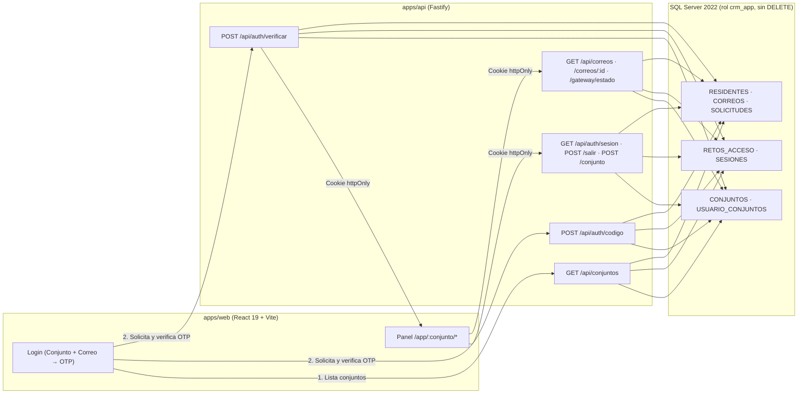

# MailFlow — Entrevista de diseño del backend y conexión con el frontend

Fecha: 2026-11-14 · Alcance: **backend (`apps/api`, `apps/gateway`, `db/migrations`) + conexión HTTP en `apps/web`**.

## Visión

Conectar el nuevo frontend de **MailFlow** con el backend Fastify y SQL Server, incorporando el modelo **multi-conjunto** en la base de datos transaccional con un único conjunto registrado inicialmente: **Parque Central de Occidente** (`parque-central-occidente`).



## Decisiones

| # | Tema | Decisión |
|---|---|---|
| 1 | Fases del backend | **B1 (esta fase):** conjuntos en BD + `GET /api/conjuntos` + acceso con código OTP por correo + sesión real (`httpOnly`) + proteger/filtrar rutas actuales + conectar el login del frontend. **B2 (siguiente):** endpoints de F2 (buzón en MailFlow, solicitudes, detalle, validación y escrituras T2–T4/T7) |
| 2 | Conjunto único inicial | Nombre oficial: **Parque Central de Occidente**, slug `parque-central-occidente`, paleta verde bosque (`#355E3B`, acento `#D6A64F`, secundario `#789653`). Se alinean las referencias de `apps/web` |
| 3 | Modelo multi-conjunto en BD | Nueva migración `0007_conjuntos_y_acceso.sql`: tabla `dbo.CONJUNTOS`, tabla intermedia `dbo.USUARIO_CONJUNTOS(idUsuario, idConjunto, rol, activo)` manteniendo `UX_Usuarios_correo(correo)` único por persona, e `idConjunto NOT NULL` en `RESIDENTES`, `CORREOS` y `GATEWAY_CHECKPOINT` (asociando las filas existentes a Parque Central de Occidente) |
| 4 | Integridad entre conjuntos en SQL Server | 1) `UX_Residentes_correo` pasa a `(idConjunto, correo) WHERE correo IS NOT NULL`. 2) `UX_Correos_messageId` pasa a `(idConjunto, messageId)`. 3) FK compuesta `CORREOS(idConjunto, idResidente) → RESIDENTES(idConjunto, idResidente)` para impedir cruzar residentes entre conjuntos incluso cuando `idResidente` es `NULL`. 4) Trigger en `ASIGNACIONES` que exige que el responsable y quien asigna tengan membresía activa en el conjunto de la solicitud |
| 5 | Email Gateway e ingesta (`T1`) | Variable `IMAP_CONJUNTO_SLUG` en `.env` (por defecto `parque-central-occidente`) y enlace de `GATEWAY_CHECKPOINT` con `idConjunto`. En `ingestarCorreo`, `idConjunto` es opcional con valor por defecto del conjunto inicial para preservar las 311 pruebas actuales y sumar pruebas multi-conjunto |
| 6 | Envío del código de 6 dígitos | Interfaz `EnviadorCodigo` con adaptador SMTP (`nodemailer`, compatible con contraseña de aplicación de Gmail) y adaptador local en desarrollo/pruebas cuando no hay SMTP configurado |
| 7 | Retos OTP en la BD (`RETOS_ACCESO`) | Tabla `dbo.RETOS_ACCESO` por `(idConjunto, correo)` con hash `HMAC-SHA256` del código (nunca en claro), `venceEn` (10 min), `reenvioDisponibleEn` (60 s), `intentosFallidos` (máx. 5), `bloqueadoHasta` (15 min) y `consumidoEn`. Una **fila por `(idConjunto, correo)`** (índice único): pedir otro código actualiza esa fila con `UPDATE` y no inserta otra, y no reinicia `intentosFallidos`. Se opera con `UPDLOCK` en `withTx` y sin `DELETE` (compatible con `crm_app`). Registra retos "fantasma" (`existeUsuario = 0`) para correos no registrados a fin de garantizar la no-enumeración |
| 8 | Sesión (`SESIONES` + cookie `httpOnly`) | Cumple el ADR 9: cookie `httpOnly` (`SameSite=Lax`, `Path=/api`) cuyo token aleatorio se guarda hasheado (`SHA-256`) en `dbo.SESIONES(idSesion, tokenHash, idUsuario, idConjuntoActivo, creadaEn, ultimaActividad, revocadaEn)`. Sin `DELETE`: cerrar sesión marca `revocadaEn`. El servidor valida los 30 min de inactividad en cada petición y el frontend rehidrata con `GET /api/auth/sesion` |
| 9 | Cambio de conjunto activo | `POST /api/auth/conjunto` valida en `dbo.USUARIO_CONJUNTOS` que el usuario tenga membresía activa en el conjunto destino, actualiza `idConjuntoActivo` en `dbo.SESIONES` y devuelve la `Sesion` con el rol de ese conjunto, sin pedir nuevo OTP |
| 10 | Semilla de conjunto y usuarios | La migración `0007` inserta **Parque Central de Occidente**. Al arrancar la API, si `ADMIN_INICIAL_CORREO` está definido en `.env`, asegura ese usuario como `ADMIN` del conjunto (sin commitear correos personales); en modo desarrollo asegura también `admin@demo.mailflow.test` y `soporte@demo.mailflow.test` |
| 11 | Protección de rutas actuales | Desde B1, `/api/correos`, `/api/correos/:id` y `/api/gateway/estado` exigen sesión válida (`401` sin cookie o vencida por inactividad) y filtran por el `idConjuntoActivo` de la sesión (`404` si un correo pertenece a otro conjunto). Quedan públicos `/api/salud`, `GET /api/conjuntos`, `POST /api/auth/codigo` y `POST /api/auth/verificar` |
| 12 | Conexión en `apps/web` | Se implementan `conjuntosHttp` y `authHttp` contra `/api/*` como servicios predeterminados en `apps/web/src/services/index.ts`. Los mocks se conservan para las pruebas unitarias de Vitest y cuando `VITE_USAR_MOCK=1` |

### Decisiones confirmadas (usuario, 2026-11-14)

1. **Sin `DEFAULT` de `idConjunto` en la BD.** Olvidar el conjunto falla. Solo `ingestarCorreo` conserva un valor por defecto (decisión 5).
2. **Manda `USUARIO_CONJUNTOS.rol`.** La sesión y el trigger de `ASIGNACIONES` usan la membresía. `USUARIOS.rol` queda heredada; sus lectores migran en B2.
3. **Un reto por `(idConjunto, correo)`** (precisa la decisión 7). Sin límite por IP en B1: es requisito previo a exponer la API fuera de `127.0.0.1`.

## Esquema SQL de la migración `0007_conjuntos_y_acceso.sql` (borrador)

La migración aplicada es `db/migrations/0007_conjuntos_y_acceso.sql`; añade CHECK, índices y el trigger que este borrador no detalla. El bloque se conserva como referencia.

```sql
CREATE TABLE dbo.CONJUNTOS (
    idConjunto      INT IDENTITY(1,1) CONSTRAINT PK_Conjuntos PRIMARY KEY,
    slug            VARCHAR(80)   NOT NULL CONSTRAINT UQ_Conjuntos_slug UNIQUE,
    nombre          NVARCHAR(120) NOT NULL,
    logoUrl         NVARCHAR(500) NULL,
    colorPrimario   CHAR(7)       NULL,
    colorAcento     CHAR(7)       NULL,
    colorSecundario CHAR(7)       NULL,
    activo          BIT           NOT NULL CONSTRAINT DF_Conjuntos_activo DEFAULT 1,
    fechaCreacion   DATETIME2     NOT NULL CONSTRAINT DF_Conjuntos_fecha DEFAULT SYSUTCDATETIME()
);

CREATE TABLE dbo.USUARIO_CONJUNTOS (
    idUsuario   INT         NOT NULL CONSTRAINT FK_UsuConj_Usuarios  REFERENCES dbo.USUARIOS(idUsuario),
    idConjunto  INT         NOT NULL CONSTRAINT FK_UsuConj_Conjuntos REFERENCES dbo.CONJUNTOS(idConjunto),
    rol         VARCHAR(30) NOT NULL,
    activo      BIT         NOT NULL CONSTRAINT DF_UsuConj_activo DEFAULT 1,
    fechaAlta   DATETIME2   NOT NULL CONSTRAINT DF_UsuConj_fecha  DEFAULT SYSUTCDATETIME(),
    CONSTRAINT PK_UsuarioConjuntos PRIMARY KEY (idUsuario, idConjunto)
);

CREATE TABLE dbo.RETOS_ACCESO (
    idReto              BIGINT IDENTITY(1,1) CONSTRAINT PK_RetosAcceso PRIMARY KEY,
    idConjunto          INT           NOT NULL CONSTRAINT FK_Retos_Conjuntos REFERENCES dbo.CONJUNTOS(idConjunto),
    correo              NVARCHAR(320) NOT NULL,
    codigoHash          BINARY(32)    NOT NULL,
    existeUsuario       BIT           NOT NULL,
    venceEn             DATETIME2     NOT NULL,
    reenvioDisponibleEn DATETIME2     NOT NULL,
    intentosFallidos    TINYINT       NOT NULL CONSTRAINT DF_Retos_intentos DEFAULT 0,
    bloqueadoHasta      DATETIME2     NULL,
    consumidoEn         DATETIME2     NULL,
    creadoEn            DATETIME2     NOT NULL CONSTRAINT DF_Retos_creado DEFAULT SYSUTCDATETIME()
);

CREATE TABLE dbo.SESIONES (
    idSesion         BIGINT IDENTITY(1,1) CONSTRAINT PK_Sesiones PRIMARY KEY,
    tokenHash        BINARY(32) NOT NULL CONSTRAINT UQ_Sesiones_token UNIQUE,
    idUsuario        INT        NOT NULL CONSTRAINT FK_Sesiones_Usuarios  REFERENCES dbo.USUARIOS(idUsuario),
    idConjuntoActivo INT        NOT NULL CONSTRAINT FK_Sesiones_Conjuntos REFERENCES dbo.CONJUNTOS(idConjunto),
    creadaEn         DATETIME2  NOT NULL CONSTRAINT DF_Sesiones_creada    DEFAULT SYSUTCDATETIME(),
    ultimaActividad  DATETIME2  NOT NULL CONSTRAINT DF_Sesiones_actividad DEFAULT SYSUTCDATETIME(),
    revocadaEn       DATETIME2  NULL
);
```

## Contratos HTTP de B1

| Método y ruta | Entrada | Respuesta exitosa | Errores |
|---|---|---|---|
| `GET /api/conjuntos` | — | `200 Conjunto[]` (solo activos) | `500` |
| `POST /api/auth/codigo` | `{ conjuntoId, correo }` | `200 { venceEn, reenvioDisponibleEn }` | `422` validación, `429 { codigo: 'REENVIO_PRONTO' \| 'BLOQUEADO', desbloqueoEn? }` |
| `POST /api/auth/verificar` | `{ conjuntoId, correo, codigo }` | `200 Sesion` + `Set-Cookie: mailflow_sesion=...; HttpOnly; SameSite=Lax; Path=/api` | `400 { codigo: 'CODIGO_INCORRECTO', intentosRestantes }`, `410 { codigo: 'CODIGO_VENCIDO' }`, `429 { codigo: 'BLOQUEADO', desbloqueoEn }` |
| `GET /api/auth/sesion` | Cookie `mailflow_sesion` | `200 Sesion` (renueva `ultimaActividad`) | `401 { codigo: 'NO_AUTENTICADO' \| 'SESION_INACTIVA' }` |
| `POST /api/auth/conjunto` | `{ conjuntoId }` + Cookie | `200 Sesion` (cambia `idConjuntoActivo`) | `401`, `403`, `422` |
| `POST /api/auth/salir` | Cookie `mailflow_sesion` | `200 { ok: true }` + limpia cookie y marca `revocadaEn` | — |
| `GET /api/correos` | Query `q, limite, desplazamiento` + Cookie | `200 { total, correos }` del `idConjuntoActivo` | `401`, `422` |
| `GET /api/correos/:id` | Param `id` + Cookie | `200 DetalleCorreo` (si pertenece al `idConjuntoActivo`) | `401`, `404`, `422` |
| `GET /api/gateway/estado` | Cookie | `200 EstadoGateway` del `idConjuntoActivo` | `401` |
