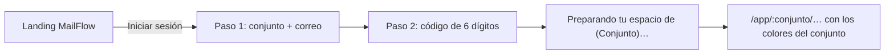

# MailFlow — Entrevista de diseño del frontend

Fecha: 2026-11-13 · Alcance: **solo frontend** (`apps/web`). El backend se conectará después.

## Visión

El panel deja de ser un sitio de un solo conjunto (Parques del Occidente) y pasa a ser **MailFlow**, un emprendimiento que atiende varios conjuntos residenciales. Los residentes siguen escribiendo por correo; al panel solo entra el personal del conjunto.



## Decisiones

| # | Tema | Decisión |
|---|---|---|
| 1 | Stack | React 19 + Vite 7 + Tailwind v4 + shadcn (última CLI, `cssVariables: true`, OKLCH) + React Router 7 en modo SPA |
| 2 | Migración | Proyecto nuevo en `apps/web` (scaffold limpio con `shadcn init`). Se reutiliza la lógica de `lib/`, `types/` y `services/`; las pantallas se reescriben con componentes shadcn |
| 3 | Usuarios | Solo personal del conjunto (Administrador y Soporte). Los residentes no tienen cuenta |
| 4 | Landing | Landing de producto MailFlow (B2B): hero, cómo funciona (correo → clasificación → seguimiento), beneficios y seguridad / Ley 1581. Se elimina el sitio público de Parques del Occidente |
| 5 | Login | Una tarjeta con 2 pasos. **Paso 1:** Combobox con búsqueda para el conjunto + correo. **Paso 2:** `InputOTP` de 6 dígitos, botón para reenviar (cuenta regresiva de 60 s), "cambiar correo" y vencimiento del código a los 10 min. El último conjunto elegido se recuerda en `localStorage` |
| 6 | Backend simulado | Interfaces de servicio (`authService`, `conjuntosService`, …) con contratos futuros (`GET /conjuntos`, `POST /auth/codigo`, `POST /auth/verificar`) e implementación mock con latencia y errores configurables. Código de demostración visible en desarrollo (`123456`). El buzón sigue contra la API real |
| 7 | Identidad MailFlow | Azul tinta `#1E3A5F` (primario), marfil `#FAF9F6` (fondo), ámbar suave `#E0A458` (acento) y neutros pizarra cálidos. Busca transmitir elegancia, seguridad y cercanía |
| 8 | Tema por conjunto | Cada conjunto **personaliza su colorimetría según su marca**, en tiempo de ejecución y sin recompilar. La paleta viene en los datos del conjunto y se aplica sobrescribiendo las variables CSS de shadcn en `<html>`. Sin paleta, se usa la de MailFlow |
| 8b | Configuración del tema | Pantalla **"Identidad del conjunto"** (solo Administrador): logo, nombre, color primario y acento con vista previa en vivo. La app deriva el resto (hover, claro, foreground, ring) en OKLCH y **bloquea las combinaciones que no cumplan contraste AA**. Parques del Occidente arranca con su paleta actual (`#355E3B`, `#789653`, `#D6A64F`) |
| 9 | Alcance por fases | **F1:** landing, login OTP, tema dinámico y layout con sidebar de shadcn. **F2:** buzón, solicitudes, detalle y validación. **F3:** residentes, usuarios, catálogos e identidad del conjunto. **F4:** reportes, auditoría y laboratorio de IA (+ 403/404) |
| 10 | Seguridad del login | Siempre el mismo mensaje neutro: "Si el correo está registrado en este conjunto, recibirás un código" (así no se puede averiguar qué correos existen). Máximo 5 intentos de código y luego bloqueo de 15 min. Mensajes claros para código vencido o incorrecto |
| 11 | Varios conjuntos | La sesión es `{ usuario, conjuntoActivo }`. Si el correo pertenece a varios conjuntos, aparece un selector en el menú de usuario y el tema cambia al instante. Hoy no se pide un código nuevo al cambiar |
| 12 | Casos vacíos | Componente `EmptyState` reutilizable (shadcn `empty`): icono, título, descripción y acción. Distingue "aún no hay datos" (con acción) de "filtros sin resultados" (con "limpiar filtros"). Ver catálogo abajo |
| 13 | URLs | El conjunto va en la ruta: `/app/:conjunto/…` (p. ej. `/app/parques-occidente/bandeja`). Si el usuario no pertenece a ese slug → 403 |
| 14 | Datos y estado | TanStack Query para datos del servidor (queryKey `['conjunto', slug, …]`), Zustand solo para sesión, tema y preferencias, y React Hook Form + Zod para formularios |
| 15 | Tipografía | Plus Jakarta Sans (títulos) + Inter (texto), servidas desde el propio proyecto con `@fontsource`. No cambia por conjunto |
| 16 | Modo oscuro | **Se elimina.** Solo modo claro |
| 17 | Marca dentro del panel | Co-branding discreto: logo y nombre del conjunto arriba en el sidebar y "Impulsado por MailFlow" al pie. Al entrar, pantalla breve "Preparando tu espacio de (Conjunto)…" con fundido de colores de unos 400 ms (se respeta `prefers-reduced-motion`) |
| 18 | Conversión en la landing | Sin formulario ni sección de contacto. Solo el CTA "Iniciar sesión" |
| 19 | Logo | Logotipo "MailFlow" en Plus Jakarta Sans + isotipo SVG hecho en código (sobre cuya solapa forma un trazo de flujo, azul tinta con detalle ámbar). Favicon derivado del isotipo |
| 20 | Sesión | Solo cierre por **inactividad a los 30 min**, con un diálogo de aviso 1 min antes. Sin duración fija ni "confiar en este dispositivo" |
| 21 | Documentación | Al implementar se actualizan `CLAUDE.md` y `README.md` (stack nuevo, paleta MailFlow, sin modo oscuro, temas por conjunto). Se mantiene la verificación con Playwright a 375 px y en escritorio |

## Catálogo de casos vacíos y de borde

| Caso | Dónde | Qué se muestra |
|---|---|---|
| No hay conjuntos disponibles | Login, paso 1 | "Aún no hay conjuntos habilitados" y el Combobox deshabilitado |
| El conjunto no aparece en la lista | Login, paso 1 | Texto de ayuda: "¿No encuentras tu conjunto? Comunícate con tu administración" |
| Conjunto recién creado | Dashboard | Bienvenida con checklist: conectar el buzón de Gmail, personalizar la identidad, invitar usuarios y cargar residentes |
| Sin buzón de correo conectado | Buzón | Explica cómo funciona + acción "Conectar buzón" (solo Administrador) |
| Sin solicitudes | Solicitudes / Dashboard | "Todavía no llegan solicitudes" con un enlace a la bandeja |
| Filtros sin resultados | Listados | "Ningún resultado con estos filtros" + "Limpiar filtros" |
| Sin residentes / usuarios | Residentes / Usuarios | Acción "Agregar" o "Invitar" (solo Administrador) |
| Sin datos para reportes | Reportes | Rango vacío, con una sugerencia para ampliarlo |
| Cola de validación vacía | Validación | Mensaje positivo: "Todo al día" |
| Conjunto sin logo o sin colores | Todo el panel | Se usan el tema MailFlow y las iniciales del conjunto como avatar |
| Slug ajeno o inexistente | `/app/:conjunto` | 403 o 404 |
| Sesión vencida por inactividad | Global | Vuelve al login con el conjunto preseleccionado y el aviso "Tu sesión se cerró por inactividad" |

Toda pantalla tiene estados de **carga** (skeleton), **vacío** y **error** (con "Reintentar"), además de contraste AA, foco visible y navegación por teclado. Los textos de la interfaz van en español.

## Modelo de datos del frontend (borrador)

```ts
interface Conjunto {
  id: string;
  slug: string;            // 'parques-occidente'
  nombre: string;
  logoUrl?: string;
  paleta?: { primario: string; acento: string }; // hex; el resto se deriva
}

interface Sesion {
  usuario: { id: string; nombre: string; correo: string; rol: 'ADMIN' | 'SOPORTE' };
  conjuntoActivo: Conjunto;
  conjuntos: Conjunto[];   // a los que pertenece
  ultimaActividad: number;
}
```

## Pendiente para el backend (fuera de este alcance)

- Endpoints de conjuntos, envío y verificación del código, y sesión.
- Columnas de identidad por conjunto (logo y paleta) y relación usuario ↔ conjunto (migración nueva, sin tocar 0002–0006).
- Enviar el código por correo y limitar intentos en el servidor.
